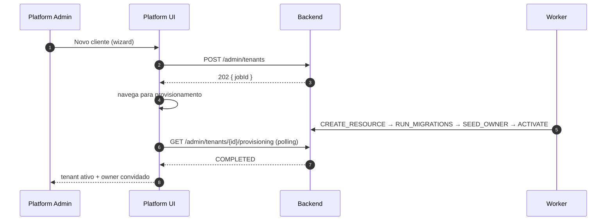
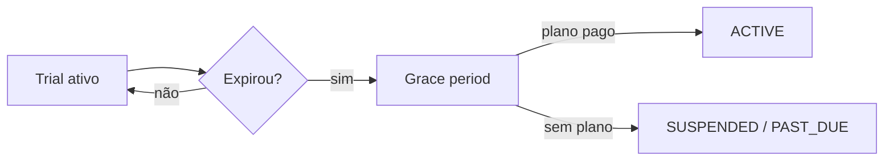
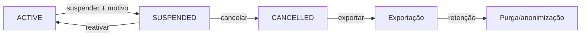
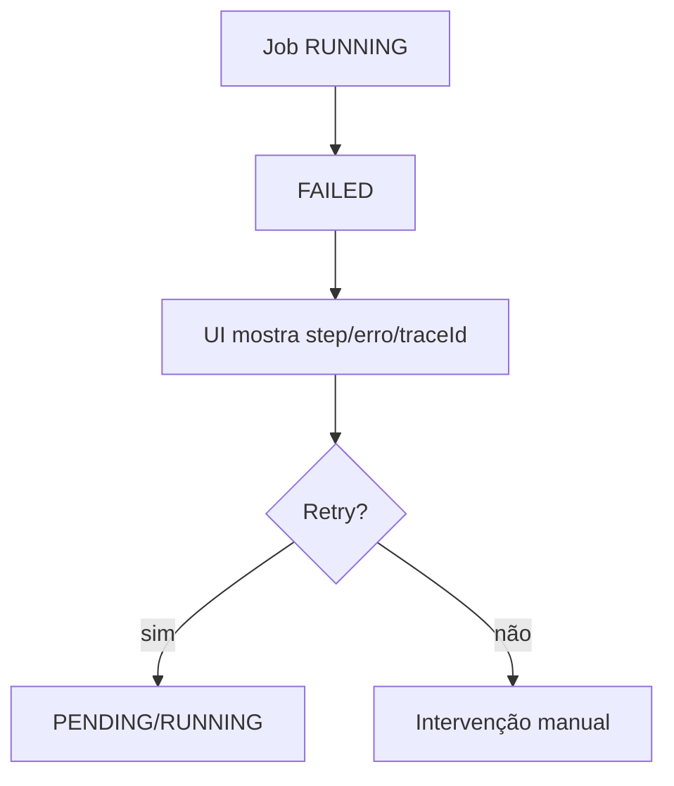

# Especificação — Gestão de Clientes SaaS (Platform Admin)

> Especificação funcional da área de **gestão de clientes/tenants** do ERP SaaS.
> Foco: operação da plataforma (quem vende e administra o SaaS), não o dia a dia do cliente dentro do ERP.
>
> Referências: [`FUNCIONALIDADES.md`](FUNCIONALIDADES.md), [`docs/api-contract.md`](docs/api-contract.md), [`docs/login-and-shell.md`](docs/login-and-shell.md), changes do backend `hybrid-tenancy`, `tenant-admin`, `identity-auth` e `lgpd-foundation`.

---

## 1. Objetivo e escopo

Criar a área **Platform Admin** do frontend para permitir que a equipe interna:

- cadastre e provisione novos clientes (tenants);
- acompanhe o provisionamento e a saúde de cada tenant;
- gerencie ciclo de vida (trial, ativo, suspenso, cancelado);
- gerencie planos, assinaturas, entitlements e quotas;
- gerencie owner/usuários, domínios e configurações;
- consulte uso, auditoria e privacidade;
- atue em suporte com segurança e rastreabilidade.

**Não é** o painel do cliente (tenant admin). O cliente tem o próprio painel em `/app`, com permissões `OWNER`/`ADMIN`.

---

## 2. Personas e permissões

| Persona | Descrição | Permissões propostas |
|---|---|---|
| `PLATFORM_ADMIN` | Administrador da plataforma | Tudo em `/platform/**` |
| `PLATFORM_FINANCE` | Financeiro/comercial | Planos, assinaturas, uso; leitura de tenants; sem infraestrutura |
| `PLATFORM_SUPPORT` | Suporte | Leitura de tenants, auditoria, impersonation (futuro); sem ações destrutivas |
| `PLATFORM_READONLY` | Auditoria/observador | Somente leitura |

> Essas roles são uma **proposta de RBAC de plataforma**. O backend hoje define `PLATFORM_ADMIN`; as demais devem ser confirmadas/implementadas no backend.

### Matriz de permissões

| Funcionalidade | ADMIN | FINANCE | SUPPORT | READONLY |
|---|---:|---:|---:|---:|
| Dashboard | ✅ | ✅ | ✅ | ✅ |
| Listar/consultar tenant | ✅ | ✅ | ✅ | ✅ |
| Criar/provisionar tenant | ✅ | ❌ | ❌ | ❌ |
| Suspender/reativar/cancelar | ✅ | ❌ | ❌ | ❌ |
| Planos (CRUD) | ✅ | ✅ | ❌ | ❌ |
| Assinatura (atribuir/trocar/trial) | ✅ | ✅ | ❌ | ❌ |
| Usage/quotas | ✅ | ✅ | ✅ | ✅ |
| Entitlements (override) | ✅ | ✅ | ❌ | ❌ |
| Usuários/owner do tenant | ✅ | ❌ | ✅ (leitura) | ✅ (leitura) |
| Domínios | ✅ | ❌ | ❌ | ✅ (leitura) |
| Auditoria | ✅ | ✅ | ✅ | ✅ |
| Privacidade/LGPD | ✅ | ❌ | ✅ (leitura) | ✅ (leitura) |
| Impersonation | ✅ | ❌ | ✅ (futuro) | ❌ |
| Configurações da plataforma | ✅ | ❌ | ❌ | ❌ |

---

## 3. Conceitos exibidos na UI

| Conceito | O que o usuário vê |
|---|---|
| **Tenant** | Cliente SaaS (ex.: “Grupo ACME”). Fronteira de isolamento, plano e cobrança |
| **Tier** | `ENTERPRISE` (banco dedicado) ou `STANDARD` (schema por tenant) |
| **Status técnico** | `PROVISIONING`, `TRIAL`, `ACTIVE`, `SUSPENDED`, `CANCELLED` |
| **Status comercial** | `TRIAL`, `ACTIVE`, `PAST_DUE`, `CANCELED` |
| **Plano** | Catálogo global com limites e features |
| **Assinatura** | Vínculo tenant ↔ plano, com período/trial |
| **Entitlement** | Feature habilitada por plano ou override |
| **Quota** | Limite de uso (usuários, storage, API requests etc.) |
| **Uso** | Consumo atual por métrica |
| **Provisionamento** | Job que cria banco/schema, migra, cria owner e ativa |
| **Domínio** | Subdomínio/domínio do tenant |
| **Owner** | Usuário `OWNER` do tenant |

---

## 4. Arquitetura de informação

### Rotas

```text
/platform
├── /platform/dashboard
├── /platform/tenants
├── /platform/tenants/new
├── /platform/tenants/:id
│   ├── /platform/tenants/:id/provisioning
│   ├── /platform/tenants/:id/subscription
│   ├── /platform/tenants/:id/usage
│   ├── /platform/tenants/:id/entitlements
│   ├── /platform/tenants/:id/users
│   ├── /platform/tenants/:id/domains
│   ├── /platform/tenants/:id/audit
│   └── /platform/tenants/:id/privacy
├── /platform/plans
├── /platform/plans/new
├── /platform/plans/:id
├── /platform/audit
├── /platform/privacy
└── /platform/settings
```

### Menu

```text
Plataforma
├── Dashboard
├── Clientes (Tenants)
├── Planos
├── Auditoria
├── Privacidade
└── Configurações
```

- Rota `/platform` protegida por `platformGuard` + permissão.
- Layout próprio (não usar o shell do tenant) ou shell com menu “Plataforma” separado.
- Contexto de tenant **não** se aplica ao Platform Admin; o tenant é selecionado por rota (`:id`).

---

## 5. Funcionalidades

## SAAS-01 — Dashboard de clientes

**Objetivo:** dar visão geral da base de clientes e da operação.

**Rota:** `/platform/dashboard`

**O que exibir:**

- KPIs:
  - total de tenants;
  - ativos, trial, suspensos, cancelados;
  - em provisionamento;
  - provisionamentos com falha;
  - trials expirando em 7/30 dias;
  - tenants com quota acima de 80%/100%;
  - incidentes de privacidade abertos.
- Gráficos:
  - tenants por status;
  - tenants por tier;
  - tenants por plano;
  - novos tenants por mês;
  - sucesso/falha de provisionamento.
- Listas rápidas:
  - últimos tenants criados;
  - provisionamentos com falha (com ação “ver/retry”);
  - trials expirando;
  - alertas de quota.
- Ações:
  - “Novo cliente”;
  - “Ver todos”;
  - “Reprocessar provisionamento”.

**API:** `GET /api/v1/admin/tenants`, `GET /api/v1/admin/tenants/{id}/provisioning`, `GET /api/v1/admin/tenants/{id}/usage`.

**Regras:**

- Dados agregados; sem PII desnecessária.
- Cada card/lista tem loading/empty/error.
- Falha em uma seção não quebra a página.

**Aceite:** dashboard carrega; filtros de período (quando existirem); ações navegam corretamente.

---

## SAAS-02 — Listagem de tenants

**Objetivo:** localizar e operar clientes.

**Rota:** `/platform/tenants`

**Colunas:**

- Nome + slug;
- Tier (`ENTERPRISE`/`STANDARD`);
- Plano;
- Status técnico;
- Status comercial;
- Owner (nome/e-mail mascarado);
- Criado em;
- Trial até;
- Provisionamento (status/step);
- Uso (alerta);
- Última atualização.

**Filtros:**

- texto (nome/slug/owner);
- status;
- tier;
- plano;
- período de criação;
- trial expirando;
- provisionamento com falha;
- quota acima do limite.

**Ações por linha:**

- Ver detalhe;
- Copiar slug;
- Suspender/reativar;
- Reprocessar provisionamento;
- Ver assinatura;
- Ver uso.

**Ações de topo:**

- Novo cliente;
- Exportar CSV (quando aprovado);
- Atualizar.

**Regras:**

- Ações destrutivas com confirmação e motivo.
- Ações visíveis conforme permissão.
- Paginação server-side; `pageSize` máx. 100.
- Estado vazio com CTA “Novo cliente”.
- Nunca exibir credenciais de banco.

**Aceite:** filtros combinam; paginação/ordenação funcionam; ações respeitam permissões.

---

## SAAS-03 — Criar cliente (wizard de onboarding)

**Objetivo:** cadastrar e provisionar um novo tenant.

**Rota:** `/platform/tenants/new`

**Etapas:**

1. **Dados do cliente**
   - nome;
   - slug (validação `^[a-z0-9_]{3,30}$` e unicidade);
   - documento/CNPJ (opcional na fase 1);
   - contato operacional (nome/e-mail/telefone).
2. **Tier**
   - `STANDARD` (schema por tenant) ou `ENTERPRISE` (banco dedicado);
   - explicação de isolamento/custo;
   - tier imutável após provisionamento.
3. **Plano**
   - selecionar plano ativo;
   - mostrar limites/features;
   - opção de trial (duração).
4. **Owner**
   - nome/e-mail do owner;
   - Papel `OWNER`;
   - convite/reset de senha.
5. **Domínio**
   - subdomínio sugerido a partir do slug;
   - domínio customizado (opcional, futuro);
   - validação de unicidade.
6. **Revisão e confirmação**
   - resumo de todos os dados;
   - aceite de termos/DPA (checkbox);
   - `Idempotency-Key`;
   - botão “Criar e provisionar”.

**Após submit:**

- `202 Accepted` com `jobId`;
- navegar para `/platform/tenants/:id/provisioning`;
- exibir timeline do job.

**API:**

- `POST /api/v1/admin/tenants`
- `GET /api/v1/admin/plans`
- `GET /api/v1/admin/tenants/{id}/provisioning`

**Regras:**

- Não permitir slug duplicado.
- Não permitir plano inativo.
- Não permitir tier inválido.
- Não criar owner com e-mail inválido.
- Não expor senha de banco.
- Confirmação explícita antes de provisionar.
- Em caso de erro, manter dados do formulário.

**Aceite:** wizard valida cada etapa; criação retorna job; redireciona para provisionamento; idempotência evita duplicidade.

---

## SAAS-04 — Detalhe do tenant

**Objetivo:** centralizar a operação de um cliente.

**Rota:** `/platform/tenants/:id`

**Header:**

- nome, slug, status, tier, plano;
- ações: editar, suspender/reativar, cancelar, retry de provisionamento, impersonation (futuro).

**Abas:**

| Aba | Conteúdo |
|---|---|
| Visão geral | contatos, owner, domínio, criado em, tier, banco (sem credenciais), última migração, saúde |
| Provisionamento | timeline, steps, tentativas, erro, retry |
| Assinatura | plano, status, trial, período, histórico, trocar/cancelar/reativar |
| Uso/quotas | métricas, limites, alertas, reset |
| Entitlements | features do plano + overrides |
| Usuários | memberships, papéis, convite, remoção |
| Domínios | domínios, primário, status |
| Auditoria | eventos do tenant |
| Privacidade | DSR, consentimento, retenção, incidentes (quando aplicável) |

**Regras:**

- Nunca exibir senha/credencial de banco.
- Dados de PII mascarados conforme permissão.
- Ações destrutivas com confirmação e motivo.
- Cada aba tem loading/empty/error.

**Aceite:** todas as abas carregam; ações refletem no header; auditoria registra.

---

## SAAS-05 — Provisionamento

**Objetivo:** acompanhar e corrigir a criação técnica do tenant.

**Rota:** `/platform/tenants/:id/provisioning`

**O que exibir:**

- status do job (`PENDING`, `RUNNING`, `COMPLETED`, `FAILED`);
- step atual (`CREATE_RESOURCE`, `RUN_MIGRATIONS`, `SEED_OWNER`, `ACTIVATE`);
- tentativas e timestamps;
- erro (sanitizado);
- logs (sem credenciais);
- relação de migrações aplicadas;
- botão “Reprocessar” (quando `FAILED`);
- link para migrações do tenant.

**API:**

- `GET /api/v1/admin/tenants/{id}/provisioning`
- `POST /api/v1/admin/tenants/{id}/provisioning/retry`
- `POST /api/v1/admin/tenants/{id}/migrations`

**Regras:**

- Polling controlado (ex.: 5s) ou refresh manual.
- Não permitir retry em job `RUNNING`.
- Exibir `traceId`/`jobId` para suporte.
- Nunca exibir senha de banco.

**Aceite:** timeline reflete estado real; retry funciona; falha tem mensagem acionável.

---

## SAAS-06 — Ciclo de vida do tenant

**Objetivo:** suspender, reativar e cancelar clientes com segurança.

**Rotas/ações:** no detalhe do tenant.

**Ações:**

- **Suspender**: exige motivo; bloqueia login/API; não apaga dados.
- **Reativar**: restabelece acesso; registra motivo.
- **Cancelar**: agenda retenção; bloqueia acesso; permite exportação; purga futura.
- **Trial → ativo**: atribuir plano pago.
- **Past due**: marcar/regularizar (financeiro).

**Regras:**

- Confirmação com digitação do slug para ações críticas.
- Motivo obrigatório.
- Auditoria obrigatória.
- Cancelamento não apaga dados imediatamente.
- Exibir impacto (“o cliente perderá acesso imediatamente”).
- Ações bloqueadas se já estiver no estado.

**Aceite:** cada transição é confirmada, auditada e refletida no status.

---

## SAAS-07 — Assinatura e plano do tenant

**Objetivo:** gerenciar o plano comercial do cliente.

**Rota:** `/platform/tenants/:id/subscription`

**O que exibir:**

- plano atual, status, trial, período, `cancel_at_period_end`;
- histórico de planos;
- limites/features do plano;
- ações: trocar plano, iniciar trial, cancelar, reativar.

**API:**

- `GET/PUT /api/v1/admin/tenants/{id}/subscription`
- `POST /api/v1/admin/tenants/{id}/subscription/trial`
- `POST /api/v1/admin/tenants/{id}/subscription/cancel`
- `POST /api/v1/admin/tenants/{id}/subscription/reactivate`
- `GET /api/v1/admin/plans`

**Regras:**

- Um plano ativo por tenant.
- Não atribuir plano inativo.
- Troca de plano mostra impacto (limites/features).
- Cancelamento no fim do período por padrão.
- Trial só se não houver assinatura ativa.

**Aceite:** troca reflete limites/features; cancelamento/reativação funcionam; histórico visível.

---

## SAAS-08 — Catálogo de planos

**Objetivo:** administrar planos, limites e features.

**Rota:** `/platform/plans`

**Listagem:**

- code, nome, tier sugerido, ativo, nº de tenants, limites, features;
- filtros por ativo/tier;
- ações: editar, ativar/inativar.

**Formulário:**

- code, nome, descrição;
- tier sugerido;
- limites (usuários, memberships, storage, API requests, jobs);
- features (multi-select);
- ativo/inativo.

**Regras:**

- code único.
- Não excluir plano em uso; apenas inativar.
- Alteração de limites não deve quebrar tenants existentes sem aviso.
- Mostrar impacto estimado.

**Aceite:** CRUD funciona; plano inativo não aparece no wizard de criação.

---

## SAAS-09 — Uso e quotas

**Objetivo:** acompanhar consumo e riscos de limite.

**Rota:** `/platform/tenants/:id/usage`

**O que exibir:**

- cards por métrica: usado/limite, percentual, período, reset;
- alerta quando ≥ 80% e ≥ 100%;
- gráfico de evolução (quando disponível);
- filtros por período;
- ação “ver assinatura/plano”.

**API:** `GET /api/v1/admin/tenants/{id}/usage`.

**Regras:**

- Nunca expor dados de outro tenant.
- Percentual calculado com proteção para limite zero.
- Indicar “sem limite” quando aplicável.

**Aceite:** uso reflete backend; alertas visíveis; navegação para plano.

---

## SAAS-10 — Entitlements

**Objetivo:** habilitar/desabilitar features por tenant.

**Rota:** `/platform/tenants/:id/entitlements`

**O que exibir:**

- features do plano;
- overrides (habilitado/desabilitado, expiração);
- origem (plano/override);
- busca/filtro.

**Ações:**

- criar/remover override;
- definir expiração;
- salvar com confirmação.

**API:** `GET/PUT /api/v1/admin/tenants/{id}/entitlements`.

**Regras:**

- Negação por padrão.
- Override temporário deve expirar.
- Auditoria obrigatória.
- Não permitir override em feature inexistente.

**Aceite:** feature reflete no tenant; override auditado; expiração funciona.

---

## SAAS-11 — Usuários e owner do tenant

**Objetivo:** apoiar o cliente na gestão de acesso.

**Rota:** `/platform/tenants/:id/users`

**O que exibir:**

- memberships (nome, e-mail mascarado, status, papéis);
- owner atual;
- convites pendentes.

**Ações:**

- convidar usuário;
- reenviar convite;
- suspender/remover membership;
- transferir owner (futuro);
- reset de senha (futuro).

**API:** `/api/v1/users`, `/api/v1/tenant-memberships` (com permissão de plataforma).

**Regras:**

- Não remover o último `OWNER`.
- Ações sensíveis com confirmação e motivo.
- Não exibir senha/token.
- Auditoria.

**Aceite:** owner visível; convite/remoção funcionam; última owner protegida.

---

## SAAS-12 — Domínios

**Objetivo:** gerenciar subdomínio/domínio do tenant.

**Rota:** `/platform/tenants/:id/domains`

**O que exibir:**

- domínios cadastrados;
- primário;
- status de verificação DNS (futuro);
- data de criação.

**Ações:**

- adicionar domínio;
- remover (exceto primário sem substituto);
- definir primário;
- copiar URL.

**API:** `GET/POST/DELETE /api/v1/admin/tenants/{id}/domains` (**a definir no backend**).

**Regras:**

- Domínio único global.
- Formato válido.
- Não permitir remover o único domínio.
- Auditoria.

**Aceite:** domínio reflete no login/subdomínio; unicidade validada.

---

## SAAS-13 — Auditoria

**Objetivo:** rastrear ações da plataforma e do tenant.

**Rota:** `/platform/tenants/:id/audit` e `/platform/audit`

**O que exibir:**

- data/hora, ator, ação, recurso, resultado, `traceId`;
- filtros por tenant, ator, ação, período, resultado;
- detalhe em drawer;
- exportação (quando aprovada).

**API:** `GET /api/v1/audit-logs`, `GET /api/v1/admin/privacy/audit`.

**Regras:**

- Somente leitura.
- Sem PII/segredos.
- Paginação e filtros server-side.
- `traceId` copiável.

**Aceite:** eventos de criação/suspensão/plano/quota aparecem; filtros funcionam.

---

## SAAS-14 — Privacidade/LGPD (visão da plataforma)

**Objetivo:** apoiar conformidade e offboarding.

**Rota:** `/platform/privacy`

**O que exibir:**

- DPO/contato;
- políticas;
- inventário (RoPA) resumido;
- DSRs (quando a plataforma apoia o tenant);
- incidentes;
- retenção/purga;
- exportação/exclusão de tenant (offboarding).

**API:** `/api/v1/admin/privacy/**`, `/api/v1/privacy/**`.

**Regras:**

- Dados PII mascarados.
- Ações destrutivas com confirmação e motivo.
- Auditoria.
- Purga real só com aprovação jurídica.

**Aceite:** DSR/incidentes visíveis; offboarding com exportação antes da purga.

---

## SAAS-15 — Suporte e impersonation

**Objetivo:** permitir que o suporte veja o tenant como o cliente, com segurança.

**Rota:** ação no detalhe do tenant.

**Fluxo:**

1. Suporte informa motivo e duração.
2. Sistema emite acesso temporário (token/claim).
3. UI entra no tenant com banner “Modo suporte”.
4. Ações são auditadas com ator original + tenant.
5. Acesso expira automaticamente.

**API:** **a definir no backend** (endpoint de impersonation).

**Regras:**

- Somente `PLATFORM_SUPPORT`/`PLATFORM_ADMIN`.
- Tempo limitado.
- Motivo obrigatório.
- Banner visível.
- Auditoria completa.
- Nunca permitir ações destrutivas em modo suporte (ou exigir reautenticação).

**Aceite:** acesso temporário, auditado e expirado.

---

## SAAS-16 — Notificações operacionais

**Objetivo:** avisar a equipe sobre eventos críticos.

**Eventos:**

- provisionamento falhou;
- trial expirando;
- quota ≥ 80%/100%;
- tenant suspenso/cancelado;
- incidente de privacidade;
- migração falhou.

**Canais:** in-app, e-mail/Slack (futuro).

**Regras:**

- Agrupar por tenant/tipo.
- Link para a tela correspondente.
- Marcar como lido.
- Não expor PII.

---

## SAAS-17 — Relatórios e exportação

**Objetivo:** apoiar operação/comercial.

**Relatórios:**

- lista de tenants (CSV);
- tenants por status/plano/tier;
- trials expirando;
- uso/quotas;
- falhas de provisionamento;
- auditoria (CSV).

**Regras:**

- Exportação assíncrona quando grande.
- Link com expiração.
- Auditoria de exportação.
- Sem credenciais/PII desnecessária.

---

## SAAS-18 — Configurações da plataforma

**Objetivo:** parâmetros globais.

**Itens (fase futura):**

- planos padrão;
- duração de trial;
- políticas de retenção;
- templates de e-mail;
- feature flags;
- status page/incidentes;
- integrações (billing, e-mail).

**Regras:**

- Somente `PLATFORM_ADMIN`.
- Auditoria.
- Confirmação para mudanças globais.

---

# 6. Fluxos end-to-end

## 6.1 Onboarding de cliente



## 6.2 Trial → pago



## 6.3 Suspender/reativar



## 6.4 Falha de provisionamento



---

# 7. Mapa de API

| Funcionalidade | Endpoint | Status no backend |
|---|---|---|
| Listar tenants | `GET /api/v1/admin/tenants` | Existente (`hybrid-tenancy`) |
| Criar tenant | `POST /api/v1/admin/tenants` | Existente |
| Detalhe tenant | `GET /api/v1/admin/tenants/{id}` | Existente |
| Editar tenant | `PATCH /api/v1/admin/tenants/{id}` | Existente |
| Suspender/reativar | `POST /api/v1/admin/tenants/{id}/suspend|reactivate` | Existente |
| Provisionamento | `GET /api/v1/admin/tenants/{id}/provisioning` | Existente |
| Retry provisionamento | `POST /api/v1/admin/tenants/{id}/provisioning/retry` | Existente |
| Migrações | `POST /api/v1/admin/tenants/{id}/migrations` | Existente |
| Planos | `/api/v1/admin/plans` | Existente (`tenant-admin`) |
| Assinatura | `/api/v1/admin/tenants/{id}/subscription` | Existente |
| Trial/cancelar/reativar | `/api/v1/admin/tenants/{id}/subscription/*` | Existente |
| Uso | `GET /api/v1/admin/tenants/{id}/usage` | Existente |
| Entitlements | `GET/PUT /api/v1/admin/tenants/{id}/entitlements` | Existente |
| Usuários/memberships | `/api/v1/users`, `/api/v1/tenant-memberships` | Existente (`identity-auth`) |
| Auditoria | `/api/v1/audit-logs` | Existente |
| Privacidade | `/api/v1/admin/privacy/**` | Existente (`lgpd-foundation`) |
| Domínios | `/api/v1/admin/tenants/{id}/domains` | **A definir** |
| Owner/transferência | `/api/v1/admin/tenants/{id}/owner` | **A definir** |
| Impersonation | `/api/v1/admin/tenants/{id}/impersonate` | **A definir** |
| Health por tenant | `/api/v1/admin/tenants/{id}/health` | **A definir** |
| Billing/faturas | `/api/v1/admin/tenants/{id}/invoices` | **Futuro** |
| Notificações | `/api/v1/admin/notifications` | **A definir** |
| Exportação | `/api/v1/admin/tenants/export` | **A definir** |

---

# 8. Regras de UX e segurança

- Toda ação crítica (suspender, cancelar, trocar plano, remover owner, purgar) exige **confirmação** e **motivo**.
- Exibir claramente o **impacto** antes de confirmar.
- Nunca exibir credenciais de banco, tokens ou segredos.
- Mascarar PII (e-mail/documento) conforme permissão.
- Ações bloqueadas por status/permissão devem ser **ocultas ou desabilitadas com explicação**.
- Toda ação deve gerar **auditoria** com ator, tenant, motivo, `traceId`.
- Estados de **loading/empty/error** em todas as listas/abas.
- Erros 422 mapeados por campo; 429 com `Retry-After`; 500 com `traceId`.
- Acessibilidade: teclado, foco, aria, contraste.
- i18n: pt-BR default.
- Responsivo: mobile/tablet/desktop.

---

# 9. Critérios de aceite da área

- [ ] Dashboard com KPIs/listas e estados.
- [ ] Listagem de tenants com filtros, paginação e ações.
- [ ] Wizard de criação com validação, idempotência e redirecionamento para provisionamento.
- [ ] Detalhe com abas (visão geral, provisionamento, assinatura, uso, entitlements, usuários, domínios, auditoria, privacidade).
- [ ] Provisionamento com timeline, erro e retry.
- [ ] Ciclo de vida com confirmação/motivo/auditoria.
- [ ] Planos e assinaturas funcionando.
- [ ] Uso/quotas e entitlements visíveis e editáveis conforme permissão.
- [ ] Usuários/owner com proteção do último owner.
- [ ] Domínios (quando backend existir).
- [ ] Auditoria filtrável.
- [ ] Privacidade/LGPD visível.
- [ ] Permissões aplicadas (UI + rota).
- [ ] Acessibilidade e responsividade.
- [ ] `pnpm lint`, `typecheck`, `test`, `build` verdes.
- [ ] `openspec validate <change> --strict` verde.

---

# 10. Fora de escopo (fase inicial)

- Billing/faturas reais e emissão fiscal.
- Checkout self-service.
- DNS automatizado de domínio customizado.
- Data residency/multi-região.
- Analytics avançado/MRR.
- Impersonation antes de endpoint seguro no backend.
- Purga real de tenant sem aprovação jurídica.

---

# 11. Roadmap de implementação

| Fase | Entrega |
|---|---|
| **A** | Dashboard, listagem e detalhe (somente leitura) |
| **B** | Wizard de criação, provisionamento e ciclo de vida |
| **C** | Planos, assinaturas, uso/quotas, entitlements |
| **D** | Usuários/owner, domínios, auditoria, privacidade |
| **E** | Impersonation, notificações, relatórios, configurações |

Cada fase deve ser uma change OpenSpec com protótipo, specs, design, tasks e testes.

---

# 12. Definition of Done

- [ ] Protótipo em `docs/design/prototypes/platform-<tela>/`.
- [ ] Specs em Gherkin.
- [ ] Design com C4/sequência quando cruzar camadas.
- [ ] Tasks ≤ 2h.
- [ ] i18n, a11y e responsividade.
- [ ] Testes unitários/componente/E2E.
- [ ] Swagger/Bruno do backend cobrindo os endpoints usados.
- [ ] Auditoria e permissões.
- [ ] Sem PII/segredos na UI/logs.
- [ ] `openspec validate <change> --strict`.
