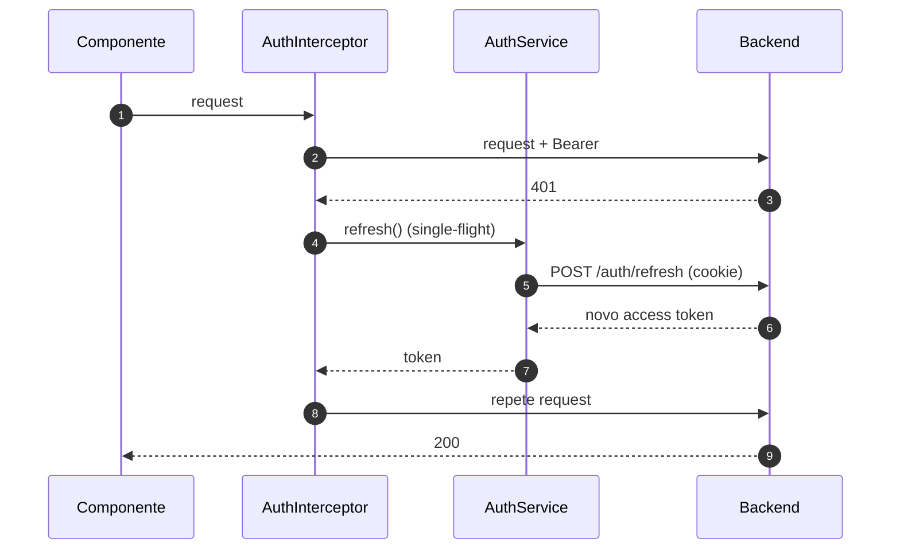

# Contrato de API — Frontend ↔ Backend Java

Base: `/api/v1` (configurável em `environment.apiUrl`).

---

## 1. Headers

| Header | Quando | Descrição |
|---|---|---|
| `Authorization: Bearer <accessToken>` | Rotas autenticadas | JWT RS256 |
| `X-Tenant-Id` | Login e rotas autenticadas | Slug do tenant (subdomínio ou campo) |
| `X-Empresa-Id` | Após seleção de contexto | Empresa ativa |
| `X-Empresa-Filial-Id` | Após seleção de contexto | Filial ativa |
| `X-Request-Id` | Todas | Correlação (UUID gerado no front) |
| `Accept-Language` | Todas | `pt-BR`, `en`, `es` |
| `Content-Type` | POST/PUT/PATCH | `application/json` |
| `Idempotency-Key` | Criação de tenant/provisionamento | Evita duplicidade |

> O backend valida que `X-Tenant-Id` coincide com o claim `tenant_id` do JWT. Nunca confie apenas no header.

---

## 2. Autenticação

| Método | Path | Body | Retorno |
|---|---|---|---|
| `POST` | `/auth/login` | `{ tenant, email, password }` | `{ data: { accessToken, refreshToken, expiresIn, user, tenant, roles } }` |
| `POST` | `/auth/refresh` | refresh token (cookie ou body) | novo par |
| `POST` | `/auth/logout` | — | 204 |
| `POST` | `/auth/logout-all` | — | 204 |
| `GET` | `/auth/me` | — | usuário, tenant, roles, permissions, memberships |
| `POST` | `/auth/switch-tenant` | `{ tenant }` | novo access token |
| `POST` | `/auth/forgot-password` | `{ email, tenant? }` | 202 (sempre) |
| `POST` | `/auth/reset-password` | `{ token, newPassword }` | 200 |
| `POST` | `/auth/verify-email` | `{ token }` | 200 |
| `POST` | `/auth/resend-verification` | `{ email, tenant? }` | 202 |

### 2.1 Estratégia de tokens (frontend)

**Alvo:**

- **Access token** em memória (signal no `AuthService`).
- **Refresh token** em **cookie HttpOnly/Secure/SameSite** definido pelo backend.
- `HttpClient` com `withCredentials: true`.
- Renovação automática em 401, com fila (uma única chamada de refresh).
- Logout limpa estado e cookies.

**Ajuste necessário no backend:** o `identity-auth` deve setar o cookie de refresh na resposta de login/refresh. Enquanto isso não acontecer, usar fallback de memória **apenas em desenvolvimento** — nunca `localStorage`.

### 2.2 Fluxo de refresh



Se o refresh falhar → logout + redirecionar para `/auth/login`.

---

## 3. Contexto (tenant/empresa/filial)

| Método | Path | Uso |
|---|---|---|
| `GET` | `/auth/me` | memberships e empresas/filiais disponíveis |
| `POST` | `/auth/switch-tenant` | trocar tenant |
| `GET` | `/tenant/settings` | configurações do tenant |
| `GET` | `/tenant/subscription` | plano/assinatura (leitura) |
| `GET` | `/tenant/usage` | uso/quotas (leitura) |
| `GET` | `/tenant/entitlements` | features habilitadas |

- Após login, carregar memberships/empresas/filiais.
- Se houver mais de uma empresa/filial, abrir seletor.
- Persistir seleção na sessão.
- Enviar `X-Empresa-Id` e `X-Empresa-Filial-Id` em todas as requisições seguintes.

---

## 4. Erros (RFC 7807)

```json
{
  "type": "https://api.exemplo.com/errors/validation",
  "title": "Erro de validação",
  "status": 422,
  "detail": "Um ou mais campos são inválidos.",
  "instance": "/api/v1/auth/login",
  "traceId": "4bf92f3577b34da6a3ce929d0e0e4736",
  "errors": [
    { "field": "email", "code": "invalid_email", "message": "E-mail inválido" }
  ]
}
```

### 4.1 Mapeamento de UX

| Status | UX |
|---|---|
| 400 | Toast/banner com mensagem de negócio |
| 401 | Tentar refresh; se falhar, login |
| 403 | Página/serviço de acesso negado |
| 404 | Página de não encontrado |
| 409 | Toast de conflito |
| 422 | Erros por campo no formulário |
| 429 | Mensagem com `Retry-After` |
| 500 | Página de erro com `traceId` |

- Nunca exibir stack trace.
- Exibir `traceId` em erros 500 para suporte.

---

## 5. Paginação, filtros e ordenação

Request:

```json
{
  "page": 1,
  "pageSize": 20,
  "sort": "-createdAt,name",
  "filters": {
    "nome": "acme",
    "status": "ACTIVE"
  }
}
```

Response:

```json
{
  "data": [ ... ],
  "meta": {
    "page": 1,
    "pageSize": 20,
    "total": 123,
    "totalPages": 7
  }
}
```

- `pageSize` máximo 100.
- Filtros explícitos por recurso.
- Datas em ISO-8601; exibição no locale.

---

## 6. Endpoints administrativos (plataforma)

Usados por um futuro painel administrativo (mesmo frontend ou app separado):

- `GET/POST/PATCH /admin/tenants`
- `POST /admin/tenants/{id}/suspend`
- `POST /admin/tenants/{id}/reactivate`
- `GET /admin/tenants/{id}/provisioning`
- `GET/POST/PATCH /admin/plans`
- `PUT /admin/tenants/{id}/subscription`
- `GET /admin/tenants/{id}/usage`
- `GET/PUT /admin/tenants/{id}/entitlements`
- `GET /admin/privacy/**` (LGPD)

Devem ser protegidos por permissões de plataforma (`PLATFORM_ADMIN`).

---

## 7. Requisitos de segurança no frontend

- Não armazenar refresh token em `localStorage`.
- Não logar tokens/PII.
- Sanitizar HTML; evitar `innerHTML` não confiável.
- CSP compatível com o build.
- CORS coordenado com o backend.
- Limpar sessão em logout e em 401 irrecuperável.
- Não incluir PII em URL/query string.

---

## 8. Ambientes

```ts
export const environment = {
  production: false,
  apiUrl: 'http://localhost:8080/api/v1',
  tenantHeader: 'X-Tenant-Id',
  requestIdHeader: 'X-Request-Id',
};
```

- `local`: backend local.
- `staging`: backend de homologação.
- `prod`: backend de produção.
- Nunca hardcodar URLs de produção no código.
