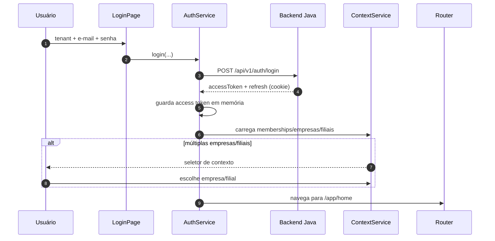

# Login e Shell — Estrutura Reaproveitada

Este documento descreve o que será reaproveitado do `congresso` para o login e a página principal do ERP SaaS, e o que precisa ser adaptado.

---

## 1. Login

### 1.1 Origem no congresso

```text
apps/frontend/src/app/features/login/auth/pages/login/
├── login-page.component.ts
├── login-page.component.html
└── login-page.component.spec.ts

apps/frontend/src/app/shared/components/ui-card.component.ts
```

### 1.2 Estrutura visual reaproveitada

- `<main>` centralizado, fundo `--color-surface`.
- Card central (`ui-card`/`uw-card`) com largura máxima (~28rem).
- Logo + subtítulo no topo.
- Formulário vertical com labels, inputs, mensagens de erro inline.
- Botão primário de largura total.
- Link “Esqueci minha senha”.
- Layout responsivo (mobile-first).
- Estados de erro e loading.

### 1.3 Adaptações para ERP SaaS

| Congresso | ERP SaaS |
|---|---|
| Seleção de perfil (administrativo/participante/avaliador) | Identificação do **tenant** (subdomínio ou campo) |
| Campo “organizador” | Campo “tenant” (slug) ou subdomínio |
| `username` | `e-mail` |
| `senha` | `senha` |
| Redireciona para `/admin`, `/participante`, `/avaliador` | Redireciona para `/app/home` ou seletor de empresa/filial |
| Login por cookie de sessão | Access token em memória + refresh HttpOnly (contrato alvo) |
| Perfil ativo no JWT | `tenant_id`, `membership_id`, `empresa_id`, `empresa_filial_id` |

### 1.4 Fluxo de login



### 1.5 Estados e erros

- Credenciais inválidas → mensagem genérica.
- Tenant inexistente/suspenso → mensagem clara (quando aplicável).
- Lockout/rate limit → mensagem com tempo de espera.
- Falha de rede → “Não foi possível conectar. Tente novamente.”
- Loading → botão desabilitado + spinner.
- Acessibilidade → `aria-invalid`, `aria-describedby`, foco no primeiro erro.

### 1.6 “Lembrar tenant”

- Persistir apenas o **slug** do tenant (nunca e-mail/senha).
- Preencher automaticamente o campo/subdomínio.
- Permitir trocar o tenant.

---

## 2. Shell / Página principal

### 2.1 Origem no congresso

```text
apps/frontend/src/app/layout/root-layout.component.ts

apps/frontend/src/app/shared/uw-ui/layout/
├── components/uw-admin-layout.component.*
├── header/
├── sidebar/
└── subheader/

apps/frontend/src/app/core/services/menu-config/menu-config.service.ts
apps/frontend/src/app/core/services/sidebar-state/sidebar-state.service.ts
```

### 2.2 Estrutura reaproveitada

- `uw-admin-layout` com:
  - sidebar fixa de 240px;
  - header com perfil/notificações;
  - subheader com breadcrumb;
  - conteúdo fluido (`router-outlet`).
- Sidebar com itens e subitens, ícones Material Symbols.
- Header com avatar/iniciais, nome, papel e menu de perfil.
- Breadcrumb por rota.
- Estado de sidebar (colapsada/expandida).
- Menu configurável por perfil/permissões.

### 2.3 Adaptações para ERP SaaS

| Congresso | ERP SaaS |
|---|---|
| Menu de eventos/inscrições/certificados | Menu de módulos de ERP: Dashboard, Cadastros, Estoque, Comercial, Compras, Agrícola, Financeiro, Fiscal, Configurações, Administração |
| `MenuConfigService` por perfil | Menu por **permissões/features** do tenant |
| Perfil `administrativo` | `OWNER`/`ADMIN`/`MEMBER`/`VIEWER` por tenant |
| Notificações de inscrições | Notificações de aprovação, estoque, financeiro (fase futura) |
| “Plano & Faturamento” no menu de perfil | Plano/assinatura do tenant (`/app/configuracoes/plano`) |

### 2.4 Menu inicial sugerido

```text
Dashboard
Cadastros
  ├── Parceiros
  ├── Itens
  ├── Cidades/UF/País
  └── Operações internas
Estoque
  ├── Saldos
  ├── Movimentos
  └── Locais
Comercial
  ├── Tabelas de preço
  └── Cálculo de preço
Compras
  ├── Solicitações
  └── Cotações
Agrícola
  ├── Contratos
  ├── Romaneios
  └── Preços
Financeiro
  ├── Títulos
  ├── Baixas
  └── Relatórios
Fiscal
  ├── Configuração fiscal
  └── NF-e
Configurações
  ├── Empresa/Filial
  ├── Usuários/Perfis
  ├── Plano/Assinatura
  └── Preferências
```

> O menu final deve ser derivado de permissões/feature flags, não hardcoded por usuário.

### 2.5 Home/dashboard

- Stat cards: títulos em aberto, estoque crítico, pedidos, faturamento (fase futura).
- Gráficos: vendas/compras por período, posição financeira.
- Atividades recentes.
- Atalhos rápidos.
- Estados de loading/empty/error.
- Dados vindos de endpoints do backend; se ainda não existirem, usar mocks explícitos na fase 1.

### 2.6 Rotas do shell

```text
/app
├── /app/home
├── /app/cadastros/...
├── /app/estoque/...
├── /app/comercial/...
├── /app/compras/...
├── /app/agricola/...
├── /app/financeiro/...
├── /app/fiscal/...
└── /app/configuracoes/...
```

- `/app` protegido por `authGuard` + `tenantGuard`.
- Rotas lazy-loaded.
- 403/404/erro fora ou dentro do shell conforme UX.

---

## 3. O que NÃO reaproveitar

- `features/administrativo/*` (eventos, inscrições, certificados, avaliadores).
- `features/participante/*`.
- `features/avaliador/*`.
- `features/publico/*`.
- Modelos e serviços de eventos.
- Rotas e menus de eventos.
- Componentes específicos de certificados/eventos.

---

## 4. Critérios de aceite

- [ ] Login com tenant/e-mail/senha funciona.
- [ ] Erros de credenciais/tenant/lockout são claros.
- [ ] Sessão persiste corretamente durante navegação.
- [ ] Refresh em 401 funciona sem loop.
- [ ] Contexto empresa/filial é selecionável.
- [ ] Shell renderiza sidebar/header/breadcrumb.
- [ ] Menu reflete permissões.
- [ ] Home renderiza indicadores/estados.
- [ ] 403/404/erro tratados.
- [ ] Acessibilidade e responsividade revisadas.
