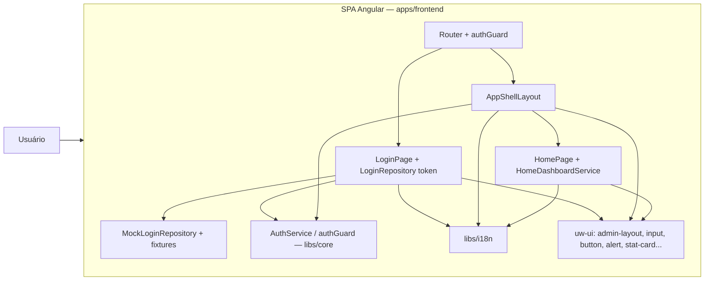
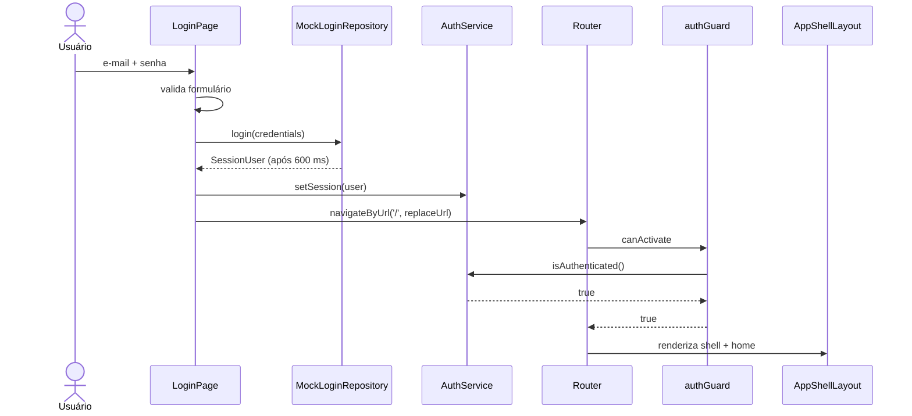

## Context

O template concluiu a fundação (workspace, `uw-ui`, tokens, `libs/core`, `libs/data`, `libs/i18n`), mas `apps/frontend` ainda oferece apenas uma página inicial pública, sem autenticação, sem guard e sem shell. A biblioteca já possui `uw-admin-layout` apresentacional (`uw-sidebar`, `uw-header`, `uw-subheader`) e um `AuthService` de sessão em memória, porém nada os consome de ponta a ponta.

Referência funcional: o projeto `congresso` usa um `RootLayoutComponent` fino que monta `uw-admin-layout` com usuário, notificações, breadcrumb e menu por perfil. Esta change reproduz a **estrutura visual e o comportamento de navegação** desse shell, com dados mockados, sem trazer o domínio de eventos, o backend ou a autenticação real.

Restrições aplicáveis:

- Frontend-only; nenhum backend ou contrato HTTP nesta change.
- Rotas lazy, standalone + signals, repository pattern, sem HTTP em componentes.
- `uw-ui` é presentacional e não conhece auth/domínio; o shell vive em `apps/frontend/src/app/layout/`.
- i18n em toda string visível (pt-BR/en/es) e WCAG 2.1 AA.
- Nenhuma biblioteca de UI de terceiros.
- ADRs em vigor: `0014` (estratégia de auth definida na change de produto) e `0015` (contrato HTTP definido na change de produto). O mock desta change é um **fixture de demonstração**, não a estratégia de autenticação de um produto — ver “Open Questions”.

## Goals / Non-Goals

**Goals:**

- Entregar um fluxo de login de exemplo com **e-mail e senha apenas**, credenciais mockadas, validação, estados de carregamento/erro/sucesso e redirecionamento.
- Entregar um shell autenticado com sidebar colapsável, header com usuário/notificações, breadcrumb e área de conteúdo, equivalente ao `congresso`.
- Proteger as rotas do shell com `authGuard` baseado em sessão em memória.
- Popular a home com dados mockados (indicadores, atividades, notificações) e estados de loading, empty, error e success.
- Manter o mock isolado atrás de uma interface de repositório, substituível por HTTP no futuro.
- Cobrir o fluxo crítico com testes unitários, de componente e E2E.

**Non-Goals:**

- Backend, endpoints, JWT, refresh token, cookie, MFA ou recuperação de senha.
- Persistência de sessão entre reloads.
- Perfis/permissões reais, multi-tenancy ou seleção de perfil/organização.
- Telas de negócio (eventos, financeiro, participantes) e seus contratos.
- Alterar componentes de `libs/uw-ui` ou criar novas histórias no Storybook.
- Preencher a seção 13 de `openspec/project.md`.

## Decisions

### D1. Mock de autenticação isolado na feature de login

- Interface `LoginRepository` + token `LOGIN_REPOSITORY` em `features/login/data/login.repository.ts`.
- `MockLoginRepository` implementa a interface com `defer(() => of(...)).pipe(delay(600))`; credenciais e usuário ficam em `login.mock-fixtures.ts`.
- A página injeta o token, nunca a classe concreta, permitindo trocar por `HttpLoginRepository` sem tocar na UI.

**Alternativas descartadas:** interceptor HTTP global de mock (polui todas as requisições e esconde a origem dos dados); mock em `libs/data` (levaria dados de demonstração para uma lib de produção); `AuthService` conhecer credenciais (acoplaria `core` a um fixture).

### D2. Sessão permanece em `libs/core`, sem persistência

`AuthService` já expõe `session`, `isAuthenticated`, `setSession` e `clearSession`. A change apenas consome essa API e adiciona `authGuard` em `libs/core/src/lib/auth/auth.guard.ts`, exportado no `public-api.ts`.

- Sessão em signal, apenas em memória (alinhado ao ADR-0014 e à regra de não guardar token em `localStorage`/`sessionStorage`).
- Recarregar a página encerra a sessão e redireciona para `/login` — comportamento esperado e documentado.
- `SessionUser` existente (`id`, `name`, `email`, `roles`) é reutilizado; o shell deriva papel traduzido e iniciais a partir dele.

**Alternativas descartadas:** persistir usuário em `localStorage` (contraria a constituição e simula uma segurança que não existe); criar um `MockAuthService` paralelo (duplicaria o estado de sessão).

### D3. Login com Reactive Forms e componentes `uw-ui`

- `LoginPageComponent` usa `FormBuilder.nonNullable` com `email` (obrigatório + e-mail) e `password` (obrigatório, mínimo 6).
- Campos com `uw-form-field` (`label`, `required`, `hint`) + `uw-input` (`type="email"`/`"password"`), erro por campo e erro de formulário em `uw-alert variant="danger"` com `role="alert"`.
- Botão `uw-button type="submit"` com `[disabled]` durante o envio e `uw-spinner` embutido/adjacente; `uw-alert variant="info"` exibe as credenciais de demonstração.
- Foco no primeiro campo inválido após submit; `aria-invalid`/`aria-describedby` quando o controle estiver inválido e tocado.
- Usuário já autenticado que acessa `/login` é redirecionado para `/`.

**Alternativas descartadas:** template-driven/`ngModel` (menos tipagem e validação); inputs nativos estilizados (quebraria o padrão de componentes do design system).

### D4. Shell compõe `uw-admin-layout` sem alterar a lib

`AppShellLayoutComponent` (`apps/frontend/src/app/layout/app-shell-layout/`) envolve as rotas filhas:

```html
<uw-admin-layout
  [menuItems]="menuItems()"
  [bottomItems]="bottomItems()"
  [breadcrumb]="breadcrumb()"
  [user]="layoutUser()"
  [unreadCount]="unreadCount()"
  [title]="pageTitle()"
  sidebarTitle="Frontend Template"
  [(collapsed)]="collapsed"
  (navigate)="onNavigate($event)"
  (logout)="onLogout()"
  (notificationsClick)="onNotifications()"
>
  <router-outlet />
</uw-admin-layout>
```

- `layoutUser`, `breadcrumb`, `unreadCount` e `pageTitle` são `computed` a partir de `AuthService.session()`, da URL atual (via `toSignal(router.events)`) e do serviço de home.
- `onNavigate` usa `router.navigateByUrl(path)`; caminho vazio (item de demonstração) exibe `uw-toast` informando que a tela não faz parte do exemplo.
- `onLogout` chama `AuthService.clearSession()` e navega para `/login` com toast de confirmação.
- `notificationsClick` exibe toast com a contagem de não lidas (o `uw-header` atual não expõe painel de notificações — ver Riscos).
- O estado `collapsed` é local do shell; não é persistido.

**Alternativas descartadas:** criar header/sidebar próprios no app (duplicaria `uw-ui`); estender `uw-header`/`uw-sidebar` com menus e painéis nesta change (aumentaria a API compartilhada e o escopo de Storybook; fica como evolução futura).

### D5. Menu mockado com itens reais e itens de demonstração

`layout/navigation/shell-menu.mock.ts` exporta `UwNavItem[]`:

- `Visão geral` → `/` (rota real).
- `Relatórios`, `Equipe`, `Configurações` → sem `path`; ao clicar, o shell exibe toast “Tela não incluída nesta demonstração”.
- `bottomItems`: `Ajuda` → sem `path`, mesmo comportamento.
- Ícones Material Symbols: `dashboard`, `bar_chart`, `group`, `settings`, `help`.

O `uw-sidebar` atual não destaca item ativo nem colapsa grupos; o mock evita depender desses recursos. Itens sem rota são explicitamente de demonstração, não links quebrados.

**Alternativas descartadas:** apontar todos os itens para `/` (parece bug); criar telas de negócio fictícias (fora do escopo).

### D6. Home com serviço de dados mockados e estados explícitos

- `HomeDashboardService` com `state: signal<'loading' | 'success' | 'empty' | 'error'>`, `metrics`, `activities` e `unreadCount`.
- `load()` simula latência de 400 ms com fixtures determinísticas; `?state=empty|error` na URL permite demonstrar e testar os estados sem alterar a UI.
- Componentes: `uw-page-header`, `uw-stat-card` (4 indicadores), `uw-card` + `uw-timeline`/lista para atividades, `uw-empty-state`, `uw-skeleton` e `uw-alert` com ação de retry.
- A ação primária “Nova atividade” e os itens de atividade exibem toast de demonstração (sem mutação real).

**Alternativas descartadas:** dados inline no componente (dificulta testes); chamadas HTTP (não há backend nesta change).

### D7. Rotas lazy com shell protegido

```text
''      → AppShellLayoutComponent (canActivate: [authGuard], lazy)
  ''    → HomePageComponent (lazy)
'login' → LoginPageComponent (lazy)
'404'   → NotFoundComponent
'**'    → NotFoundComponent
```

- `authGuard` retorna `true` ou `UrlTree` para `/login`.
- `title` por rota via i18n resolvido no shell (o `title` do Angular permanece estático nesta change).
- Breadcrumb: mapa simples `'/' → [app.title, shell.nav.overview]`; rotas futuras caem em fallback com o último segmento capitalizado.

**Alternativas descartadas:** shell não-lazy (carrega `uw-ui` de layout no bundle inicial); rotas eager (contraria a constituição).

### D8. i18n, formatação e acessibilidade

- Chaves novas em `login.*`, `shell.*` e `home.*` nos três catálogos, com paridade garantida por teste.
- Textos de estado, erros, ações e `aria-label` vindos de i18n; nenhuma string visível hardcoded.
- Datas relativas (“há 2 horas”) representadas por chaves i18n, evitando dependência de locale de `DatePipe` não registrado.
- Foco visível, ordem de tabulação, `role="alert"` em erros, `aria-live="polite"` nos estados da home, alvo mínimo de 44×44 px nos controles.
- Sidebar vira drawer em < 900 px (comportamento existente do `uw-admin-layout`), com overlay e fechamento por `Esc`/clique.
- `prefers-reduced-motion` já respeitado pelo layout; toasts não devem ser a única forma de transmitir informação crítica.

### D9. Diagramas (C4 — container/componente e dinâmica)





### D10. Protótipo e mapeamento visual

Protótipos de referência já registrados (aprovados para orientar a implementação):

- [`docs/design/prototypes/login/`](../../../docs/design/prototypes/login/) — formulário centralizado, cartão, estados de erro/loading.
- [`docs/design/prototypes/shell-home/`](../../../docs/design/prototypes/shell-home/) — sidebar 240 px, header 64 px, subheader/breadcrumb, grid de conteúdo.

Cada pasta contém `screenshot.png`, `codigo.html` e `README.md` com mapeamento de componentes, tokens, estados, responsividade e acessibilidade.

Mapeamento contra `docs/design/design-system.md`:

| Elemento | Regra / token |
|---|---|
| Sidebar | 240 px (72 px colapsada), fundo `--sidebar`, texto `--sidebar-foreground` |
| Header | `min-height: 64px`, `--color-surface`, borda `--color-outline-variant` |
| Área de conteúdo | fundo `--color-surface-container-low`, padding 24 px (16 px mobile) |
| Cartões e bordas | `--color-surface`, `--color-outline`, raio `--radius-md`/`--radius-lg` |
| Tipografia | títulos `--font-family-display`; corpo `--font-family-body` |
| Ritmo | espaçamentos múltiplos de 8 px (16/24/32) |
| Breakpoint | sidebar → drawer em 900 px |
| Feedback | `uw-toast` (transitório), `uw-alert` (persistente), `uw-empty-state` |

Componentes `uw-ui` usados: `uw-admin-layout`, `uw-sidebar`, `uw-header`, `uw-subheader`, `uw-breadcrumb`, `uw-avatar`, `uw-icon`, `uw-button`, `uw-input`, `uw-form-field`, `uw-alert`, `uw-spinner`, `uw-stat-card`, `uw-card`, `uw-page-header`, `uw-empty-state`, `uw-skeleton`, `uw-timeline` (se o layout de atividades usar linha do tempo), `uw-toast`, `uw-language-switcher`. Nenhum componente novo.

### D11. Testes

- **Unitários:** `MockLoginRepository` (sucesso, credenciais inválidas, latência/erro), `authGuard` (autenticado/não autenticado), `HomeDashboardService` (loading → success/empty/error), paridade dos catálogos i18n.
- **Componente:** `LoginPageComponent` (validação, erro, loading, redirect), `AppShellLayoutComponent` (inputs mapeados, logout, navigate, toast), `HomePageComponent` (estados).
- **E2E:** `/` sem sessão → `/login`; credenciais inválidas → erro; credenciais válidas → home; recarregar → volta ao login; logout → `/login`.
- **Qualidade:** lint, typecheck, Jest, build, Playwright.

## Risks / Trade-offs

- **Auth mockada contraria a alternativa rejeitada no ADR-0014** → isolar em repositório de demonstração, marcar claramente como exemplo na UI e registrar ADR próprio antes da implementação (ver Open Questions).
- **Sem persistência de sessão** → reload desloga; é o comportamento esperado e documentado. Não é bug.
- **`uw-header`/`uw-sidebar` não têm painel de notificações, menu de perfil, item ativo ou grupos colapsáveis** → o demo usa toast para notificações/itens sem rota e assume a versão simplificada; evolução da lib fica para change futura com Storybook.
- **`uw-form-field` não associa `for`/`id` explicitamente** → validar leitor de tela; se necessário, usar label nativo com `for` em volta do `uw-input` (o input interno é descendente no DOM) e registrar ajuste futuro na lib.
- **Strings `aria-label` hardcoded dentro de `uw-ui`** (“Sair”, “Fechar menu”) → dívida existente; não corrigir nesta change para não alterar a lib; registrar como follow-up.
- **Mudança de comportamento da rota `/`** (pública → autenticada) → é breaking por desenho; documentada no proposal e coberta por E2E.
- **Fixtures e credenciais fixas** → testes E2E dependem delas; centralizar em constantes e usar `data-testid` estáveis.
- **`?state=` exposto em produção** → inofensivo (apenas dados mockados), mas pode ser removido quando houver backend.

## Migration Plan

1. Sem migração de dados ou backend.
2. Implementar tipos/fixtures → repositório → serviço → guard → login → shell → home → testes.
3. Atualizar catálogos i18n nos três idiomas.
4. Criar os protótipos em `docs/design/prototypes/{login,shell-home}/` e validar antes da implementação visual.
5. Rollback: reverter `app.routes.ts`, remover `features/login` e `layout/`, restaurar a home anterior e remover as chaves i18n novas. Não há estado persistido a limpar.

## Open Questions

- **ADR-0014:** o ADR rejeitou “criar autenticação mock no template”. Esta change introduz um mock **de demonstração**, isolado e sem persistência. Recomendação: registrar um novo ADR (0016) que permite mock de demonstração atrás de interface, **sem superseder o 0014** (que continua regendo a autenticação real de produto). Confirmar com o time se o novo ADR é complementar ou se deve superseder o 0014.
- **Credenciais visíveis na tela:** recomendação é exibir as credenciais de demonstração em `uw-alert variant="info"` para facilitar teste/avaliação; confirmar se isso deve existir apenas em ambiente de desenvolvimento.
- **Menu de demonstração:** confirmar se itens sem rota devem exibir toast (recomendado) ou se o menu deve conter apenas “Visão geral” nesta change.
