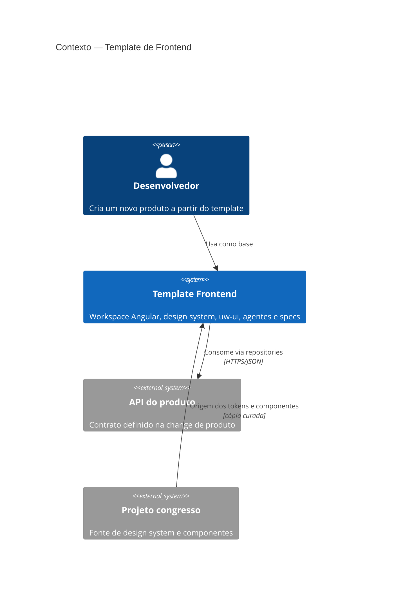
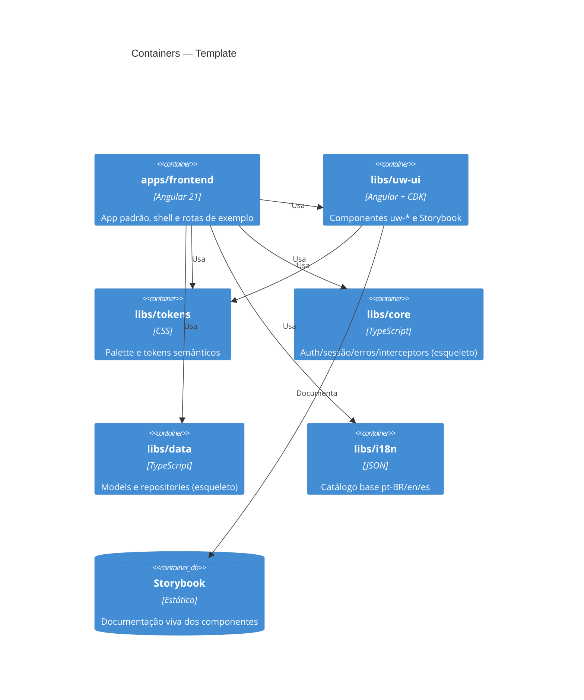
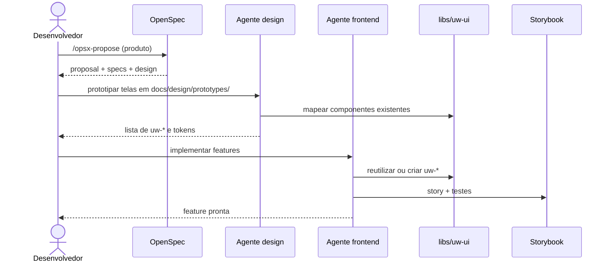

# Design — Bootstrap Frontend Template

## Context

Este repositório deixa de ser um frontend de ERP e passa a ser um **template de bootstrap** para projetos Angular futuros. A referência funcional e visual é o projeto `congresso`, que já possui Angular 21, design system documentado, biblioteca `uw-ui` madura e 43 protótipos de tela.

### Estado atual

- O commit inicial contém um seed ERP-específico (apps `erp`/`platform-admin`, docs, ADRs 0001–0009 e changes antigas). Esses arquivos estão **removidos no working tree**, restando apenas `openspec/` e `.opencode/`.
- `openspec/project.md` e `openspec/config.yaml` ainda descrevem ERP multi-tenant e referenciam documentos que não existem.
- Não há código Angular, `package.json`, workspace ou biblioteca de componentes no working tree.
- O projeto `congresso` é a fonte para design system, tokens, `uw-ui`, agentes e skills.

### ADRs anteriores (0001–0009)

Os ADRs existem apenas no histórico do git (a pasta `adr/` foi removida no working tree). Eles permanecem como decisões anteriores e devem ser reavaliados no passo `adr`:

| ADR | Tema | Situação para o template |
|---|---|---|
| 0001 | Angular standalone + signals | **Aplicável** |
| 0002 | Tailwind 4 + design tokens | **Aplicável** |
| 0003 | Biblioteca própria `uw-ui` | **Aplicável**, com triagem genérico vs. domínio |
| 0004 | Estratégia de tokens de auth | **Revisar** — específico de produto (JWT/refresh/tenant) |
| 0005 | Estado com signals e services | **Aplicável** |
| 0006 | HTTP, repositories e erros RFC 7807 | **Revisar** — generalizar contratos e remover headers de tenant |
| 0007 | Estratégia de testes | **Aplicável** |
| 0008 | i18n e acessibilidade | **Aplicável** |
| 0009 | Entrega Docker/nginx | **Aplicável** |

### Referência visual

Não há tela de produto nesta change, portanto **nenhum protótipo novo** é criado. A validação visual usa protótipos do congresso como referência de comportamento dos componentes:

- `docs/design/prototypes/dashboard/` — layout administrativo, cards, gráficos e sidebar.
- `docs/design/prototypes/usuarios/` — tabela, filtros, paginação, modal e estados.
- `docs/design/prototypes/eventos-gerenciar-tabela-grid/` — alternância tabela/grid e ações em popover.
- `docs/design/prototypes/cadastro-paises/` — CRUD básico, formulário e confirmação.

Onde a documentação do design system divergir do código, **o código-fonte da `uw-ui` e os protótipos prevalecem**.

## Goals / Non-Goals

**Goals:**

- Workspace Angular CLI multi-project executável, com um app padrão e libs reutilizáveis.
- Design system e tokens importados do congresso como fonte única de verdade.
- Biblioteca `uw-ui` genérica portada, sem acoplamento a domínio, auth ou HTTP.
- Agentes, subagentes e skills de frontend disponíveis e genericizados.
- `project.md` e `config.yaml` genéricos, com a especificação do produto em aberto.
- Quality gates e entrega (lint, typecheck, testes, Storybook, build, CI, Docker) desde o dia zero.

**Non-Goals:**

- Telas, rotas de negócio, autenticação real ou multi-tenancy de produto.
- Backend, contratos de API reais e integrações externas.
- Componentes de domínio do congresso (evento, certificado, pagamento, notificações).
- Segundo app, microfrontends, temas por tenant e dark mode.
- Deploy em infraestrutura real.

## Decisions

### D1 — Workspace Angular CLI multi-project com app único

Adotar Angular CLI multi-project (sem Nx), com:

```
apps/frontend/              # app padrão do template
libs/tokens/                # tokens CSS
libs/uw-ui/                 # componentes uw-* + Storybook
libs/core/                  # infraestrutura de app (esqueleto)
libs/data/                  # models + repositories (esqueleto)
libs/i18n/                  # catálogo base pt-BR/en/es
```

- Libs são **source-mapped** e consumidas por aliases `@app/tokens`, `@app/uw-ui`, `@app/core`, `@app/data` e `@app/i18n`.
- O app padrão chama-se `frontend`; nomes de produto são definidos na change de produto.
- Um segundo app exige ADR próprio.

**Por quê:** separa infraestrutura reutilizável de produto sem introduzir a complexidade do Nx. **Alternativas:** Nx (rejeitado por overhead e baixo ganho no bootstrap); monorepo pnpm com apps soltos (rejeitado por perder o builder e os schematics do Angular CLI).

### D2 — Direção de dependência

```
tokens ← uw-ui ← apps/*
tokens ← core ← data ← apps/*
i18n   ← apps/*
```

- `libs/uw-ui` **não** importa `core`, `data`, `i18n` nem código de feature.
- `libs/core` não importa `data` nem apps; `libs/data` pode importar `core`.
- App nunca importa app; shell, menu e rotas vivem no app.
- Regra dos três consumidores antes de promover código para `libs/`.

**Por quê:** evita ciclos e mantém a biblioteca de UI reutilizável em qualquer produto. **Alternativas:** lib única “shared” (rejeitada por misturar UI e infraestrutura); imports relativos atravessando pastas (rejeitados por acoplamento).





### D3 — Design system com código como fonte de verdade

- Tokens vivem **apenas** em `libs/tokens/src/styles/tokens/` (`palette.css`, `colors.css`, `typography.css`, `borders.css`) e `theme.css`.
- A documentação fica em `docs/design/design-system.md` e `docs/design/design-tokens.md`, com tabelas e links para os arquivos de código — **sem duplicar CSS**.
- Material Symbols é self-hosted em `libs/tokens/src/assets/fonts/`.
- Regras mantidas: superfícies sólidas, bordas 1px, sidebar 240px, grid 12 colunas, ritmo 8px, proibição de cor hardcoded e de biblioteca de UI externa.

**Por quê:** elimina a divergência entre `docs/design-tokens/*.css` e os tokens reais. **Alternativas:** copiar o CSS para `docs/` (rejeitado por drift); gerar docs a partir do CSS (possível evolução, custo desnecessário agora).

### D4 — Port da `uw-ui` em três faixas

**Faixa A — entra no template** (dependências: Angular, CDK e `ngx-mask`):

`accordion`, `action-card`, `alert`, `autocomplete`, `avatar`, `avatar-group`, `badge`, `breadcrumb`, `button`, `card`, `chart-card`, `chart-legend`, `checkbox`, `chip`, `confirmation`, `copy-field`, `date-picker`, `divider`, `doc-viewer`, `drawer`, `empty-state`, `export-menu`, `file-upload`, `filter-pills`, `form-field`, `help`, `icon`, `image`, `input`, `input-tag`, `language-switcher`, `layout`, `modal`, `otp-input`, `page-header`, `pagination`, `pick-list`, `popover`, `progress-bar`, `progress-track`, `radio-group`, `rating`, `search-field`, `section-heading`, `select`, `select-button-group`, `skeleton`, `slider`, `spinner`, `stat-card`, `status-badge`, `table`, `tabs`, `tag`, `textarea`, `timeline`, `toast`, `toggle`, `toggle-card`, `panel`, `stepper` e as diretivas `uwAutofocus`, `uwBadge`, `uwPopoverTriggerFor`, `uwRipple`, `uwTooltip`.

**Faixa B — opt-in documentado, não instalado por padrão:**

- `html-editor` (depende de `ngx-quill`/`quill`).
- `scheduler` e views (depende de `rrule`).

Receitas de instalação ficam em `docs/design/uw-ui-extending.md`.

**Faixa C — excluída por ser de domínio:** `event-context`, `certificate-layout-preview`, `score-badge` específico de avaliação, `pagamento/*`, `notifications/*`, `evento-cell`, `participante-cell`, `perfil-badge` de papéis, `sparkline` do dashboard.

**Por quê:** mantém o bootstrap leve e genuinamente genérico. **Alternativas:** portar tudo (rejeitado por arrastar Quill, rrule e acoplamentos de domínio); portar só 10 componentes (rejeitado por obrigar cada produto a reconstruir a base).

### D5 — Layout presentational e shell no app

O `layout` do congresso importa `AuthService`, `MenuConfigService`, `SidebarStateService`, `NavItem` e `NotificationItem`, violando a direção de dependência. No port:

- `libs/uw-ui/layout` expõe `UwAdminLayoutComponent`, `UwSidebarComponent`, `UwHeaderComponent` e `UwSubheaderComponent` **puramente presentational**, recebendo menu, perfil, notificações e breadcrumb via `input()` e emitindo eventos via `output()`.
- O app fornece o shell em `apps/frontend/src/app/layout/`, ligando auth/menu/estado aos inputs.
- Serviços de sessão, menu e sidebar ficam em `libs/core` (esqueleto) ou no app.

**Por quê:** a biblioteca de UI não pode conhecer auth nem domínio. **Alternativas:** manter o layout no app (rejeitado por duplicação entre produtos); criar uma lib `layout` separada (rejeitada por ser cedo demais).

### D6 — Convenção `uw-*` e renomeação dos seletores legados

- Classe `Uw<Nome>Component`, selector `uw-<nome>`, standalone, `OnPush`, `ViewEncapsulation.None`.
- Estilos globais são namespaced por `.uw-<nome>` para evitar vazamento.
- Mapeamento dos legados:

| Legado | Novo |
|---|---|
| `app-breadcrumb` | `uw-breadcrumb` |
| `app-header` | `uw-header` |
| `app-sidebar` | `uw-sidebar` |
| `app-subheader` | `uw-subheader` |
| `app-badge` | `uw-badge` |
| `app-perfil-badge` | `uw-profile-badge` |
| `app-status-badge` | `uw-status-badge` |

**Por quê:** consistência e previsibilidade para quem consome a lib. **Alternativas:** manter `app-*` (rejeitado por contrariar o ADR-0003); alias temporário (rejeitado por dívida desnecessária em bootstrap).

### D7 — Toolkit de agentes e skills

Importar de `.agents/`:

- **Agentes:** `frontend`, `design`, `testing`, `security`, `requirements`, `architect`.
- **Skills:** `design-system`, `uw-ui-usage`, `frontend-design`, `angular-developer` (com referências), `angular-new-app`, `stitch-prototyping`, `contextual-help`, `testing-patterns`, `testing-patterns-angular`, `webapp-testing`, `naming-conventions`, `error-handling`, `security-patterns`, `gherkin-authoring`, `grill-me`, `c4-diagrams`, `architectural-decision-records`, `openspec-git-discipline`, `requirements-documentation`.
- Criar `domain-context` como **placeholder** que lê `docs/domain/`; não copiar `event-domain`.
- Criar `AGENTS.md` com tabela de delegação e o fluxo obrigatório design → frontend → testing.
- Genericizar referências a “UltraEventos”, “congresso”, `apps/frontend` e paths antigos.

**Por quê:** o valor do congresso está no processo, não no domínio. **Alternativas:** copiar tudo (rejeitado por arrastar regras de evento); copiar só `frontend` (rejeitado por quebrar o fluxo design/spec).

### D8 — Constituição genérica com especificação em aberto

`openspec/project.md` passa a ter:

1. Visão geral do template e princípios.
2. Stack e estrutura (genéricos).
3. Design system e `uw-ui`.
4. Qualidade, segurança, i18n e acessibilidade.
5. **“Especificação do Frontend”** — única seção específica de produto, com placeholders:

```markdown
## Especificação do Frontend (preencher na primeira change de produto)

- Produto:
- Domínio de negócio:
- Público e perfis:
- Módulos e telas:
- Identidade visual / marca:
- API e integrações:
- Idiomas:
- Requisitos regulatórios:
```

`openspec/config.yaml` é reescrito sem apps fixos, sem auth/tenant e com regras de proposal/specs/design/tasks genéricas. O aviso do CLI `Rules for 'tasks' must be an array of strings` é investigado e eliminado; se for bug do CLI, fica registrado como issue e não bloqueia.

**Alternativas:** manter `project.md` ERP (rejeitado — contradiz o objetivo); criar `project.template.md` separado (rejeitado por duplicar a constituição).

### D9 — Baseline de qualidade, i18n e acessibilidade

- **Testes:** Jest + `jest-preset-angular` por projeto; Playwright no app; Storybook em `libs/uw-ui`.
- **Cobertura:** 80% `core`/`data`, 70% `features`, 100% pipes/diretivas de `shared`.
- **i18n:** `@ngx-translate/core`, pt-BR default, en/es opcionais; chaves base de ações, erros e navegação; nenhuma string visível hardcoded.
- **Acessibilidade:** WCAG 2.1 AA — foco visível, teclado, `aria-*`, contraste 4.5:1, `prefers-reduced-motion`.
- **Entrega:** Docker multi-stage + nginx com fallback SPA e headers de segurança; CI com lint, typecheck, test e build.

**Estados de UI** são contrato dos componentes e páginas de exemplo:

| Estado | Regra |
|---|---|
| Loading | `uw-skeleton` para conteúdo e `uw-spinner` para ações; nunca bloquear a tela inteira sem feedback |
| Empty | `uw-empty-state` com título, descrição e ação primária opcional |
| Error | mensagem + ação de retry; `uw-toast` persistente para erros que exigem ação |
| Success | `uw-toast` temporário; nunca usar modal para confirmação simples |

**Responsividade:** sidebar 240px colapsável; conteúdo fluido; breakpoints Tailwind (`sm`, `md`, `lg`, `xl`); tabelas com scroll horizontal controlado; drawers full-screen em mobile.

### D10 — Fluxo de consumo do template



## Risks / Trade-offs

- **[Doc do design system divergir do código]** → código e protótipos prevalecem; checklist de reconciliação no port e stories como contrato visual.
- **[`ViewEncapsulation.None` vazar estilos]** → namespacing `.uw-*`, revisão de PR e lint de seletor.
- **[Port arrastar acoplamento de domínio]** → allowlist da Faixa A, revisão de imports e regra ESLint `no-restricted-imports` impedindo `uw-ui → core/data/i18n`.
- **[Dependências pesadas no bootstrap]** → Faixa B opt-in, fora do `package.json` padrão.
- **[Renomear `app-*` quebrar exemplos copiados do congresso]** → tabela de mapeamento e busca global durante o port.
- **[Versões do congresso mudarem durante o port]** → registrar commit de origem do congresso no README do template.
- **[Arquivos do seed ERP removidos no working tree]** → a remoção é intencional e será commitada como parte da migration; o histórico permanece no git.

## Migration Plan

1. **Preparação:** criar branch da change; confirmar e commitar a remoção do seed ERP.
2. **Workspace:** gerar o workspace Angular CLI, app `apps/frontend` e libs; configurar aliases, Tailwind, ESLint, Prettier, Jest, Playwright e Storybook.
3. **Tokens e docs:** portar `palette/colors/typography/borders/theme`, fontes e `docs/design/design-system.md` + `docs/design/design-tokens.md`.
4. **`uw-ui`:** portar Faixa A com specs e stories, aplicar renomeações e refatorar o layout para presentational.
5. **Agentes:** portar `.agents/` genericizado, criar `domain-context` e `AGENTS.md`.
6. **Constituição:** reescrever `openspec/project.md` e `openspec/config.yaml`; validar a seção de especificação em aberto.
7. **Entrega:** Docker, nginx e CI.
8. **Validação:** `pnpm lint`, `pnpm typecheck`, `pnpm test`, `pnpm build`, `build-storybook`, `openspec validate bootstrap-frontend-template --strict` (quando aplicável).

**Rollback:** a change é aditiva, exceto pela remoção do seed. Reverter o merge/branch restaura o estado anterior; nenhum dado externo é migrado.

## Open Questions

- Nome definitivo do app padrão: `frontend` (recomendado) ou `web`.
- Faixa B (`html-editor`, `scheduler`) entra agora como opt-in documentado ou fica para uma change futura?
- Escopo do alias: `@app/*` (recomendado) ou `@template/*`.
- Confirmar o mapeamento de renomeação `app-perfil-badge → uw-profile-badge` e `app-status-badge → uw-status-badge`.
- ADRs 0004 e 0006: substituir por versões genéricas (recomendado) ou manter e apenas ignorar no template?
- Local do catálogo i18n: `libs/i18n` (recomendado) ou `apps/frontend/public/i18n`.
