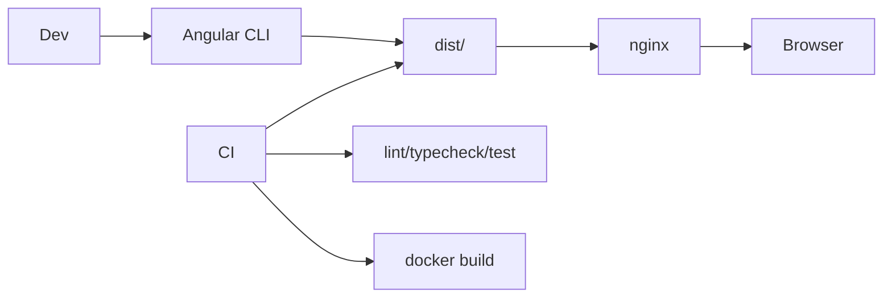

## Context

O repositório é novo e não contém código. A primeira change precisa entregar uma base executável e testável, sem antecipar login, design system ou telas de negócio. O congresso serve como referência de stack e estrutura, mas o novo projeto não é monorepo.

## Goals / Non-Goals

**Goals:**

- Projeto Angular 21 standalone executável.
- Estrutura feature-first.
- Tailwind 4 configurado.
- Lint, typecheck, Jest, Playwright e Storybook.
- Ambientes e `apiUrl`.
- CI e Docker/nginx.
- Rota inicial e 404.

**Non-Goals:**

- Login.
- Design system.
- `uw-ui`.
- Shell/home.
- API.
- i18n/a11y.

## Decisions

### D1 — Angular CLI + standalone

Usar `ng new` com `--standalone --routing --style scss --strict`. Sem NgModules de feature.

### D2 — Tailwind CSS 4

Configurar `@tailwindcss/postcss` e `styles.css` com `@import "tailwindcss"`. Tokens virão na change `design-system-foundation`.

### D3 — Estrutura

```text
src/app/{config,core,data,features,layout,shared}
src/assets
src/environments
src/styles
```

### D4 — Testes

Jest + `jest-preset-angular` para unitários/componentes; Playwright para E2E; Storybook para UI.

### D5 — Ambientes

`environment.ts` (local), `environment.staging.ts`, `environment.prod.ts` com `apiUrl`. Nunca hardcodar URL de produção.

### D6 — Docker/nginx

Multi-stage: Node 22 build → nginx runtime. `try_files` para SPA, headers de segurança, cache de assets com hash.

### D7 — CI

GitHub Actions (ou equivalente): install, lint, typecheck, test, build, e2e opcional. Cache pnpm.

## Architecture



## Risks / Trade-offs

| Risco | Mitigação |
|---|---|
| Versões Angular/Tailwind incompatíveis | Fixar versões no `package.json` e validar no bootstrap |
| Storybook pesado no CI | Rodar build do Storybook só em job separado |
| Docker/nginx divergir de produção | ADR-0009 e teste local |
| E2E lento | Rodar em job separado/paralelo |

## Migration Plan

Greenfield: não há migração. O primeiro deploy sobe uma SPA vazia com 404.

## Open Questions

1. Versão exata do Angular (21.x).
2. Node 22 e pnpm 11 confirmados?
3. Docker/nginx ou CDN estática?
4. Runtime config ou build por ambiente?
5. Storybook no CI desde o início?
